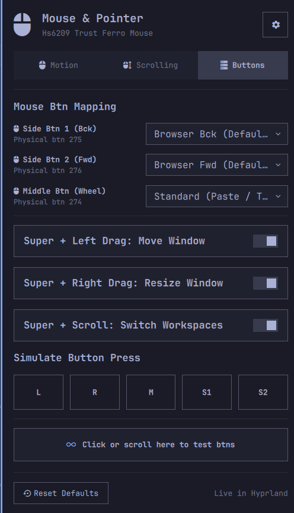
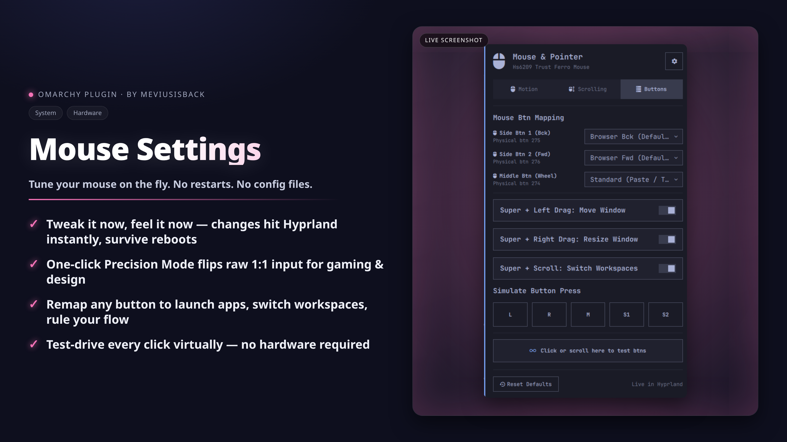

<div align="center">

# Mouse & Pointer Settings

**A graphical mouse and pointer configuration tool for Omarchy: cursor speed, one-click precision mode, scroll behavior, button remapping, synthetic button presses and live input testing — applied instantly to Hyprland.**

[](LICENSE)





</div>

## Why

Mouse feel lives in Hyprland config files most people never want to hand-edit — sensitivity curves, scroll multipliers, side-button binds. This plugin turns all of it into sliders, cards and dropdowns: tune the pointer until it feels right, remap the extra buttons to things you actually use, and test every input live, with changes applying instantly and your manual config left alone.

## Features

- **Zero restart required** — changes apply instantly to Hyprland via runtime evaluation and persist across reboots.
- **One-click precision mode** — switch instantly between raw 1:1 flat input (gaming, CAD, pixel work) and dynamic acceleration, via the panel cards, a right-click on the top bar icon, or IPC.
- **Customizable button remapping** — rebind side buttons and middle click to productivity actions (workspace switching, terminal launch, window management, move/resize, …); Super + drag and Super + wheel gestures configurable too.
- **Multiplier & natural scrolling** — scroll sensitivity from `0.2x` to `8.0x`, plus natural (touchpad/macOS-style) direction toggle.
- **Middle-button drag to scroll** — hold the middle button and move the mouse to scroll; applies immediately and persists across logins. While active, the middle button is reserved for drag-scrolling (middle-click paste/close-tab won't fire); Reset Defaults disables it.
- **Enterprise-grade reliability** — atomic writes (`os.replace` + `fsync`), POSIX concurrency locks (`fcntl.flock`), symlink-attack mitigation, strict parameter allowlists.
- **Live input verification** — interactive test canvas confirms button presses, side keys and scroll direction immediately.
- **Simulate any button press** — emit real synthetic presses of Left, Right, Middle (274), Side Back (275) or Side Forward (276) from the Buttons tab or the CLI, to test remaps and Hyprland binds without the physical buttons (powered by `ydotool`).
- **Mouse battery indicator** — remaining percentage of your wireless mouse in the panel header and tooltip (via `upower`); hidden automatically when the mouse reports no battery.
- **Smart device detection** — identifies your actual mouse even when keyboards and virtual devices appear in Hyprland's pointer list.

## Install

```bash
omarchy plugin add https://github.com/meviusisback/mouse-settings --enable
```

**Button simulation (optional):** synthetic presses rely on the user-space `ydotool` daemon (`ydotoold`) — install the `ydotool` package and keep its user service active.

## Usage

Click the bar icon (`󰍽`, highlighted when Precision/Flat is active; tooltip shows device, profile and speed) to toggle the settings card; **right-click** flips instantly between Precision (Flat 1:1) and Dynamic acceleration.

Shell IPC:

```bash
omarchy-shell meviusisback.mouse-settings toggle        # popup open/close
omarchy-shell meviusisback.mouse-settings toggleAccel  # Precision vs Dynamic
omarchy-shell meviusisback.mouse-settings open
omarchy-shell meviusisback.mouse-settings close
```

Direct CLI helper (`mouse_ctl.py`):

```bash
# Full JSON state of the mouse configuration
python3 ~/.config/omarchy/plugins/meviusisback.mouse-settings/mouse_ctl.py status

# Toggle acceleration profile / natural scroll directly
python3 ~/.config/omarchy/plugins/meviusisback.mouse-settings/mouse_ctl.py toggle-accel
python3 ~/.config/omarchy/plugins/meviusisback.mouse-settings/mouse_ctl.py toggle-natural-scroll

# Apply specific settings via JSON
python3 ~/.config/omarchy/plugins/meviusisback.mouse-settings/mouse_ctl.py apply --json-data '{
  "sensitivity": 0.2,
  "accel_profile": "flat",
  "natural_scroll": false,
  "scroll_factor": 1.4,
  "button_mappings": {
    "side_back": "prev_workspace",
    "side_forward": "next_workspace",
    "middle_click": "toggle_floating"
  }
}'

# Reset all mouse settings and button bindings to defaults
python3 ~/.config/omarchy/plugins/meviusisback.mouse-settings/mouse_ctl.py reset-defaults

# Simulate a physical mouse button press via ydotool
python3 ~/.config/omarchy/plugins/meviusisback.mouse-settings/mouse_ctl.py simulate-button --button side_back   # left|right|middle|side_back|side_forward
```

## Requirements

- Omarchy Linux with Hyprland (settings apply via runtime evaluation + `input.lua` / `bindings.lua`)
- `python3` (standard library — backend controller, atomic file I/O, notifications)
- `upower` — mouse battery indicator only
- `ydotool` package + active `ydotoold` user service — synthetic button presses only

## Configuration

Settings persist inside dedicated marker blocks in `~/.config/hypr/input.lua` and `~/.config/hypr/bindings.lua` (`-- [[ OMARCHY_MOUSE_SETTINGS_START ]]` … `_END`); all rules, comments and manual configuration outside the blocks are preserved:

```lua
return {
  sensitivity = 0.0,
  accel_profile = "flat",
  follow_mouse = 1,
  natural_scroll = false,
  touchpad = {
    natural_scroll = false,
  },
  left_handed = false,
  scroll_factor = 1.0,
  mouse_refocus = true,
}
```

| Key | Meaning |
|---|---|
| `sensitivity` | Cursor speed, `-1.0` (slow) to `+1.0` (fast), step `0.05` |
| `accel_profile` | `flat` (Precision 1:1) or adaptive (Dynamic) |
| `natural_scroll` | Natural / mobile scroll direction |
| `scroll_factor` | Scroll step sensitivity, `0.2x`–`8.0x` |
| `left_handed` | Swap left/right click |
| `follow_mouse` | Focus follows cursor |
| `mouse_refocus` | Refocus the window under the cursor when the active one closes |
| `button_mappings` | `side_back`, `side_forward`, `middle_click` actions (prev/next workspace, Omarchy menu, terminal, focus move, move/resize window, …) |

Button event reference: `mouse:275` Side Back, `mouse:276` Side Forward, `mouse:274` Middle, `mouse:272/273` Super + drag, `mouse_up/down` Super + wheel.

## How it works

`mouse_ctl.py` is the backend: it applies settings to the live Hyprland session, persists them into the marker blocks with atomic writes (temp file + `fsync` + `os.replace`) under an exclusive file lock (`~/.config/hypr/.mouse_ctl.lock`), and refuses to follow symlinks. Floats are finiteness-checked and clamped, enums matched against allowlists, subprocesses spawned with argument vectors (no shell), and all dynamic strings render via QML `Text.PlainText`. `Panel.qml` is the interface (Motion / Scrolling / Buttons tabs, bar widget, test canvas); `Model.js` holds the label/tooltip formatting helpers.

## Removal

```bash
omarchy plugin remove meviusisback.mouse-settings
```

## License

MIT — see [LICENSE](LICENSE).
